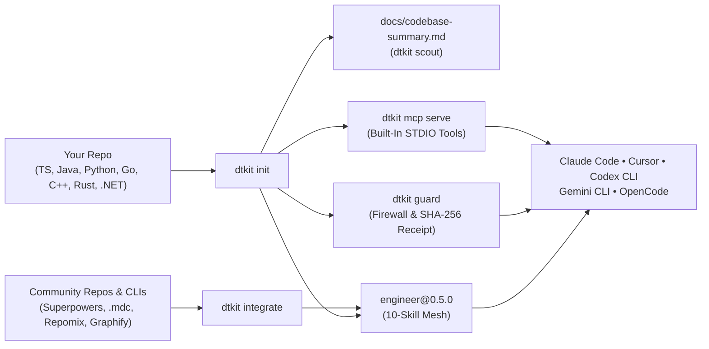
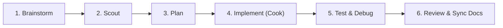

<p align="center">
  
</p>

<h1 align="center">DTKit</h1>

<p align="center">
  <strong>One single-binary CLI to equip, guard, and synchronize your AI coding agents across any repository.</strong><br/>
  Works out of the box with <strong>Claude Code</strong>, <strong>Cursor</strong>, <strong>Codex CLI</strong>, <strong>Gemini CLI</strong>, and <strong>OpenCode</strong>.
</p>

<p align="center">
  <a href="docs/guide.md"><strong>English User Guide</strong></a> ·
  <a href="docs/guide.vi.md"><strong>Hướng dẫn Tiếng Việt</strong></a> ·
  <a href="docs/cli.md"><strong>CLI Reference</strong></a> ·
  <a href="docs/compatibility.md"><strong>Compatibility Matrix</strong></a>
</p>

---

## What Problem Does DTKit Solve?

Static markdown rules (`CLAUDE.md`, `.cursorrules`, `AGENTS.md`) are useful—but on real projects, teams quickly hit three limits:

1. **Fragmented AI configs:** Every coding agent expects different files, skill folders, MCP JSON/TOML, and hook schemas. Updating them by hand across tools drifts immediately.
2. **Markdown rules alone can't enforce discipline:** An agent can still edit files while *"just planning"*, wander outside your requested module, delete assertions or add `skip` to make tests pass, or claim *"All tests passed!"* without running them.
3. **Polyglot repos waste context:** Real codebases mix stacks (`frontend/` TypeScript + `backend/` Java + `ai/` Python + native C++/Go/Rust). Letting agents blindly `grep` the whole tree burns tokens and time.

**DTKit solves all three in one zero-dependency Go binary**—and preserves your personal instructions and configurations byte-for-byte.



---

## 30-Second Quick Start

### 1. Install `dtkit` (`v0.7.0`)

**Linux / macOS (`~/.local/bin`):**

```bash
bash scripts/install.sh --version 0.7.0 --bin-dir "$HOME/.local/bin"
export PATH="$HOME/.local/bin:$PATH"
dtkit version --json
```

**Windows PowerShell (`%LOCALAPPDATA%\Programs\dtkit\bin`):**

```powershell
.\scripts\install.ps1 -Version "0.7.0"
dtkit version --json
```

Or build from source with Go `1.27.4+`:

```bash
go install github.com/truong-newbie/Agent_Kit_Impl/cmd/dtkit@v0.7.0
```

> Install scripts verify `SHA256SUMS` before extracting and roll back cleanly on failure. Each GitHub Release also attaches generated **Homebrew (`dtkit.rb`)** and **Scoop (`dtkit.json`)** manifests populated from `SHA256SUMS` (templates in `packaging/`). See [docs/release.md](docs/release.md#terminal-install--checksum-verification-pinned-version-no-admin) for manual checksum steps.

### 2. Initialize Your Project in One Command

Run inside any repository (single language or polyglot monorepo):

```bash
# Preview everything read-only first
dtkit init --runtime claude --with-mcp --with-hooks --lock --dry-run

# Apply full setup (or use --all-runtimes to configure all 5 agents at once)
dtkit init --runtime claude --with-mcp --with-hooks --lock --yes
```

That single command sets up:
- **`docs/codebase-summary.md`** — fast polyglot map of zones, languages, manifests, and API contracts (`dtkit scout`).
- **`.dtkit/project.json`** — detected `test`/`lint`/`typecheck` commands per workspace zone (approved by you before running via `dtkit check --yes`).
- **`engineer@0.5.0`** — unified 10-skill lifecycle (`Brainstorm -> Scout -> Plan -> Implement -> Test -> Review -> Docs`).
- **Auto-wired MCP & Quality Hooks** — registers `dtkit mcp serve` and `check-changed`/`guard-edit` hooks while preserving your existing servers and settings.
- **`dtkit.lock`** — pins kit digests so every teammate installs identical verified bytes.

> Add `.dtkit/local/` to `.gitignore` so personal locks, transaction journals, guard rules, and companion caches stay local.

---

## Core Features That Go Beyond Plain Markdown

### 1. Guided Engineering Lifecycle (`engineer@0.5.0`)
Instead of shipping disconnected kits per language, DTKit uses **one unified `engineer` kit** that scouts your repository's real structure and adapts to every service zone:



Need a lighter footprint? Install a focused preset anytime:
- `--preset minimal`: `ask`, `explain`, `plan` only
- `--preset review-only`: `review` + security audit checklist only
- `--preset engineering`: full 19-component skill mesh (default)

### 2. Phase Firewall & Anti-Fake-Pass Guard (`dtkit guard`)
Lock what AI agents are allowed to modify at each phase—stored in `.dtkit/local/guard.json`, which hooks protect from AI edits:

```bash
dtkit guard lock --mode read-only                      # Block 100% of file edits while planning/reviewing
dtkit guard lock --mode tdd-red                        # Allow editing tests ONLY
dtkit guard lock --mode tdd-green --allow "backend/**" # Allow source edits, protect test files from AI tampering
dtkit guard verify                                     # Fails (exit 3) if workspace changed since last passing check or tests were skipped/weakened
```

`dtkit guard verify` and `check-changed` hooks detect **test tampering** across Go, Python, JS/TS, Java/Kotlin, C/C++, Rust, and C# (`t.Skip`, `pytest.skip`, `.skip(`, `@Disabled`, `GTEST_SKIP`, `#[ignore]`, removed assertions), verify SHA-256 `verify-receipt.json` check receipts, and raise `[RETRY LOOP DETECTED]` after 3+ consecutive failures.

### 3. Polyglot Reconnaissance, Impact Graph & Built-In MCP (`dtkit scout`, `dtkit mcp`)
Scan any multi-language codebase in milliseconds without leaking `.env` files, private keys, or secrets, or compute reverse-dependency impact across Go, TS/JS, Python, Java, and C/C++:

```bash
dtkit scout --zone backend --query checkout --pack --max-bytes 24576
dtkit scout --impact backend/src/main/java/com/acme/Token.java
```

Agents can also call `dtkit_scout`, `dtkit_context_impact`, `dtkit_project_inspect`, `dtkit_guard_status`, and `dtkit_guard_verify` natively over JSON-RPC 2.0 via `dtkit mcp serve` (`dtkit mcp enable --runtime claude --yes`).

### 4. Import Community Repos & External Companions (`dtkit integrate`)
Bring in your favorite community workflows and CLI tools without giving up cross-runtime compatibility or safety:

```bash
# Convert local dirs, GitHub shorthands (owner/repo), or HTTPS Git repos into 5-runtime DTKit packages
dtkit integrate import obra/superpowers --as superpowers --install --runtime claude --yes
# Refresh an imported kit atomically when upstream updates:
dtkit integrate import obra/superpowers --as superpowers --update --install --runtime claude --yes

# Check & run external tools (repomix, graphify, ast-grep, semgrep) with SHA-256 caching and dtkit scout fallback
dtkit integrate list
dtkit integrate run repomix --zone backend
```

### 5. Safe Multi-Kit Coexistence, Forking & Team Sync
- **Side-by-side kits:** Install multiple kits (`engineer` + `superpowers` + custom forks) in the same `(runtime, scope)` cleanly via `state.json` v3.
- **Controlled customization:** Never edit managed files directly; run `dtkit fork engineer --as my-kit`, customize safely, preview bounded diffs with `dtkit diff`, and share via `dtkit lock` + `dtkit team export|import`.

---

## Supported Runtimes & Current Status

DTKit supports all five runtimes below. Labels strictly distinguish automated Go/container verification from live interactive runtime sessions (see [docs/compatibility.md](docs/compatibility.md) for the full 4-layer matrix):

| Runtime | Managed Files (Project Scope) | Quality Hooks / Plugin | MCP Config | Verification Status |
|---|---|---|---|---|
| **Codex CLI** (`codex`) | `AGENTS.md`, `.agents/skills/` | `.codex/hooks.json` (`SessionStart`) | `.codex/config.toml` | **Partial** (discovery verified on `0.169.0`; live hook firing unverified) |
| **OpenCode** (`opencode`) | `AGENTS.md` (namespaced), `.opencode/skills/` | `.opencode/plugins/dtkit-quality.js` | `opencode.json` | **Partial** (14-skill discovery verified on `1.19.5`; live session unverified without creds) |
| **Claude Code** (`claude`) | `CLAUDE.md`, `.claude/skills/` | `.claude/settings.json` (`PostToolUse`, `PreToolUse`) | `.mcp.json` | **Partial** (automated hook & lifecycle verified; live session/A-B eval blocked on creds) |
| **Gemini CLI** (`gemini`) | `GEMINI.md`, `.gemini/skills/` | `.gemini/settings.json` (`AfterTool`, `BeforeTool`) | `.gemini/settings.json` | **Experimental** (`gemini` CLI absent on verification host; offline tests pass) |
| **Cursor** (`cursor`) | `.cursor/rules/dtkit-*.mdc`, `.cursor/skills/` | `.cursor/hooks.json` (`afterFileEdit`) | `.cursor/mcp.json` | **Experimental** (`cursor` CLI absent on verification host; global rules UI-only) |

---

## Command Reference

| Area | Commands | Purpose |
|---|---|---|
| **Bootstrap & Install** | `init`, `list`, `info`, `install`, `update`, `remove`, `status`, `diff`, `recover` | 1-command onboarding, multi-kit installs, bounded diffs, atomic rollback & recovery |
| **Scout, Guard & MCP** | `scout`, `project inspect\|init`, `check`, `guard <status\|lock\|unlock\|verify>`, `hooks`, `mcp` | Polyglot reconnaissance, `.dtkit/project.json` checks, phase firewall, SHA-256 check receipts, hooks & MCP wiring |
| **Import, Fork & Pack** | `integrate <list\|import\|tool\|run>`, `fork`, `create kit\|skill`, `validate`, `pack` | Community repo importer, companion digest cache (`repomix`, `graphify`, `ast-grep`, `semgrep`), deterministic `.tar.gz` |
| **Team & Governance** | `lock <generate\|verify\|diff\|sign\|keygen>`, `sync`, `team`, `compat`, `doctor`, `completion` | Reproducible team sync, Ed25519 provenance, compat snapshots, redacted diagnostics & shell completion |

Most commands support `--dry-run`, `--diff`, `--yes`, and `--json`. See [docs/cli.md](docs/cli.md) for complete flags and exit codes (`0` OK, `1` error, `2` usage, `3` conflict/unverified, `4` missing runtime, `130` cancelled).

---

## Documentation Hub

- **User Guides:** [English Guide](docs/guide.md) · [Hướng dẫn Tiếng Việt](docs/guide.vi.md) · [CLI Reference](docs/cli.md)
- **Compatibility & Releases:** [Runtime Compatibility Matrix](docs/compatibility.md) · [Deprecation Policy](docs/compatibility-policy.md) · [Release & Troubleshooting Guide](docs/release.md) · [Support Policy](docs/support.md)
- **Development & Roadmap:** [Development Guide](docs/development.md) · [Evaluation Harness](docs/evaluation/README.md) · [Implementation Progress](docs/progress.md)
- **License:** [MIT](LICENSE)
