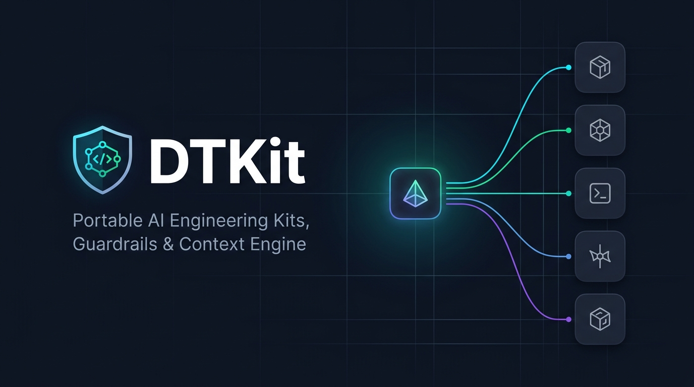
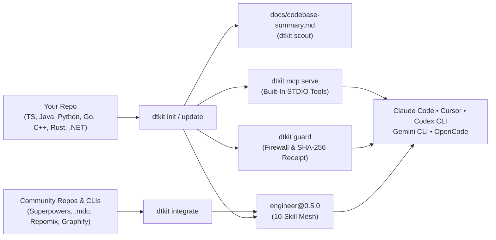
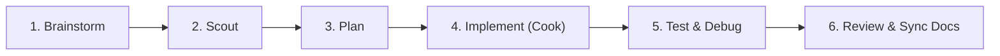

<p align="center">
  
</p>

<h1 align="center">DTKit</h1>

<p align="center">
  <strong>One single-binary CLI to equip, guard, and synchronize your AI coding agents across any repository.</strong><br/>
  Works out of the box with <strong>Claude Code</strong>, <strong>Cursor</strong>, <strong>Codex CLI</strong>, <strong>Gemini CLI</strong>, and <strong>OpenCode</strong>.
</p>

<p align="center">
  <a href="docs/guide.md"><strong>English User Guide</strong></a> ·
  <a href="docs/guide.vi.md"><strong>Hướng dẫn Tiếng Việt</strong></a> ·
  <a href="docs/cli.md"><strong>CLI Reference</strong></a> ·
  <a href="docs/compatibility.md"><strong>Compatibility Matrix</strong></a>
</p>

---

## Only 4 Commands You Need Day-to-Day

You don't have to memorize all 30 subcommands to get value from DTKit. Almost everything fits into **4 commands**:

| Command | When to Run | What It Does |
|---|---|---|
| `dtkit init --all-runtimes --with-mcp --lock --yes` | Once when setting up a repo | Scans your codebase, installs `engineer@0.5.0` skills/rules, wires MCP, and creates `dtkit.lock` without touching your custom notes. |
| `dtkit scout` / `dtkit scout --impact <file>` | Before starting a task | Maps repo zones & secrets-free code packs (`--pack`), or shows which files & tests depend on `<file>`. |
| `dtkit guard lock --mode ...` / `verify` | While coding / reviewing | Locks AI edits (`read-only`, `tdd-red`, `tdd-green`, `scoped`) and detects skipped/weakened tests. |
| `dtkit update --yes` *(or `dtkit refresh --yes`)* | Whenever your project grows | Updates `docs/codebase-summary.md`, merges new stacks into `.dtkit/project.json` (keeping your `checks`), syncs kits, and refreshes `dtkit.lock`. |

---

## Why Use DTKit Instead of Plain Markdown Rules?

Static `CLAUDE.md`, `.cursorrules`, or `AGENTS.md` files help—but real teams quickly hit three walls:

1. **Fragmented AI configs:** Every coding agent expects different files, skill folders, MCP JSON/TOML, and hook schemas. Updating them by hand across tools drifts immediately.
2. **Markdown rules alone can't enforce discipline:** An agent can still edit files while *"just planning"*, wander outside your requested module, delete assertions or insert `skip` to fake passing tests, or report *"All tests passed!"* without running them.
3. **Polyglot repos waste context:** Real codebases mix stacks (`frontend/` TypeScript + `backend/` Java + `ai/` Python + Go/C++/Rust/.NET). Letting agents blindly `grep` the whole tree burns tokens and time.

**DTKit solves all three in one zero-dependency Go binary**—and preserves your personal instructions and configurations byte-for-byte.



---

## 30-Second Quick Start

### 1. Install `dtkit` (`v0.8.0`)

**Linux / macOS (`~/.local/bin`):**

```bash
bash scripts/install.sh --version 0.8.0 --bin-dir "$HOME/.local/bin"
export PATH="$HOME/.local/bin:$PATH"
dtkit version --json
```

**Windows PowerShell (`%LOCALAPPDATA%\Programs\dtkit\bin`):**

```powershell
.\scripts\install.ps1 -Version "0.8.0"
dtkit version --json
```

Or install from Go `1.27.4+`, Homebrew (`dtkit.rb`), or Scoop (`dtkit.json`) attached to each GitHub Release (templates in `packaging/`):

```bash
go install github.com/truong-newbie/Agent_Kit_Impl/cmd/dtkit@v0.8.0
```

> **Windows Smart App Control / Application Control note:** If Windows blocks unsigned `.exe` downloads, you can run `dtkit` instantaneously via **Docker Desktop** with zero Windows policy changes:
> ```powershell
> docker build -t dtkit:0.8.0 -f - . <<'EOF'
> FROM golang:1.27.4 AS b
> WORKDIR /s
> COPY go.mod ./
> COPY cmd ./cmd
> COPY internal ./internal
> COPY schemas ./schemas
> RUN CGO_ENABLED=0 GOOS=linux go build -trimpath -ldflags "-s -w" -o /dtkit ./cmd/dtkit
> FROM alpine:3.21
> RUN apk add --no-cache git ca-certificates
> COPY --from=b /dtkit /usr/local/bin/dtkit
> ENTRYPOINT ["/usr/local/bin/dtkit"]
> EOF
> # PowerShell helper in $PROFILE:
> function dtkit { docker run --rm -i -v "${PWD}:/work" -w /work dtkit:0.8.0 @args }
> ```

### 2. Initialize Your Project

Run inside any repository (single language or polyglot monorepo):

```bash
# Preview everything read-only first (writes nothing)
dtkit init --runtime claude --with-mcp --with-hooks --lock --dry-run

# Or configure all 5 coding agents at once
dtkit init --all-runtimes --with-mcp --with-hooks --lock --yes
```

#### What Does `dtkit init` Add to Your Project?

| Path Added | Purpose | Git Recommendation |
|---|---|---|
| `docs/codebase-summary.md` | Up-to-date map of zones, languages, manifests, and API contracts. | Commit |
| `.dtkit/project.json` | Detected stacks & quality check commands (approved by you before running). | Commit |
| `.dtkit/content/` & `dtkit.lock` | Shared workflow docs and pinned kit versions/digests for teammates (`dtkit sync`). | Commit |
| `AGENTS.md`, `CLAUDE.md`, `GEMINI.md`, `.cursor/rules/`, `.agents/`, `.claude/`, `.gemini/`, `.opencode/` | Managed blocks & skill directories for your selected agent(s); personal text outside `dtkit:begin/end` is never overwritten. | Commit (or pick only `--runtime <yours>`) |
| `.mcp.json`, `.codex/config.toml`, `.cursor/mcp.json`, `.gemini/settings.json`, `opencode.json` | MCP server wiring (preserves existing servers); hooks if `--with-hooks` was passed. | Commit / review |
| `.dtkit/local/` & `.dtkit/locks/` | Local guard state (`guard.json`), check receipts (`verify-receipt.json`), transaction locks. | **Add to `.gitignore`** |

---

## Core Features That Go Beyond Plain Markdown

### 1. Guided Engineering Lifecycle (`engineer@0.5.0`)
Instead of shipping disconnected kits per language, DTKit uses **one unified `engineer` kit** that scouts your repository's real structure and adapts to every service zone:



> **Where do I invoke skills (`brainstorm`, `plan`, `implement`, `review`, ...)?**
> Do **not** type `dtkit brainstorm` or `dtkit plan` in your shell—those are **in-chat agent skills** installed by `dtkit init`, not CLI subcommands:
> - **Terminal (`dtkit ...`):** infrastructure & protection (`init`, `update`, `scout`, `guard`, `status`, `integrate`).
> - **Inside your AI Agent chat:** invoke skills directly using your runtime's syntax:
>   - **Codex CLI:** `$dtkit-project-brainstorm`, `$dtkit-project-plan`, `$dtkit-project-implement`, `$dtkit-project-review`
>   - **Claude Code:** `/dtkit-claude-project-brainstorm`, `/dtkit-claude-project-plan`, `/dtkit-claude-project-implement`
>   - **Gemini CLI / Cursor / OpenCode:** reference `dtkit-<runtime>-project-<skill>` (e.g. `dtkit-gemini-project-plan`) or simply ask *"use the DTKit brainstorm and plan skills before editing code"*.

Need a lighter footprint? Install a focused preset anytime:
- `--preset minimal`: `ask`, `explain`, `plan` only
- `--preset review-only`: `review` + security audit checklist only
- `--preset engineering`: full 19-component skill mesh (default)

### 2. Phase Firewall & Anti-Fake-Pass Guard (`dtkit guard`)
Lock what AI agents are allowed to modify at each phase—stored in `.dtkit/local/guard.json`, which `guard-edit` hooks protect from AI edits:

```bash
dtkit guard lock --mode read-only                      # Block 100% of file edits while planning/reviewing
dtkit guard lock --mode tdd-red                        # Allow editing tests ONLY
dtkit guard lock --mode tdd-green --allow "backend/**" # Allow source edits, protect test files from AI tampering
dtkit guard verify                                     # Fails (exit 3) if workspace changed since last passing check or tests were skipped/weakened
```

`dtkit guard verify` and `check-changed` hooks detect **test tampering** across Go, Python, JS/TS, Java/Kotlin, C/C++, Rust, and C# (`t.Skip`, `pytest.skip`, `.skip(`, `@Disabled`, `GTEST_SKIP`, `#[ignore]`, removed assertions), verify SHA-256 `verify-receipt.json` check receipts, and raise `[RETRY LOOP DETECTED]` after 3+ consecutive failures.

### 3. Polyglot Reconnaissance, Impact Graph & Built-In MCP (`dtkit scout`, `dtkit mcp`)
Scan any multi-language codebase without leaking `.env` files, private keys, or secrets, or compute reverse-dependency impact across Go, TS/JS, Python, Java, and C/C++:

```bash
dtkit scout --zone backend --query checkout --pack --max-bytes 24576
dtkit scout --impact backend/src/main/java/com/acme/Token.java
```

Agents can also call `dtkit_scout`, `dtkit_context_impact`, `dtkit_project_inspect`, `dtkit_guard_status`, and `dtkit_guard_verify` natively over JSON-RPC 2.0 via `dtkit mcp serve`.

### 4. One-Command Refresh When Your Project Grows (`dtkit update` / `dtkit refresh`)
Added a new `frontend/` or `ai/` service, updated an imported community kit, or changed files across the repo? Run one command:

```bash
dtkit update --dry-run   # Preview what would refresh
dtkit update --yes       # Refreshes docs/codebase-summary.md, merges new roots into .dtkit/project.json (preserving checks), syncs kits & dtkit.lock
```

### 5. Import Community Repos, External Companions & Team Sync (`dtkit integrate`)
```bash
# Convert local dirs, GitHub shorthands (owner/repo), or HTTPS Git repos into 5-runtime DTKit packages
dtkit integrate import obra/superpowers --as superpowers --install --runtime claude --yes
# Refresh an imported kit cleanly when upstream updates (auto-bumps patch version when content changes)
dtkit integrate import obra/superpowers --as superpowers --update --install --runtime claude --yes

# Check & run external tools (repomix, graphify, ast-grep, semgrep) with SHA-256 caching and dtkit scout fallback
dtkit integrate list
dtkit integrate run repomix --zone backend
```

---

## Supported Runtimes & Verification Status

See [docs/compatibility.md](docs/compatibility.md) for the full 4-layer verification matrix:

| Runtime | Managed Files (Project Scope) | Quality Hooks / Plugin | MCP Config | Verification Status |
|---|---|---|---|---|
| **Codex CLI** (`codex`) | `AGENTS.md`, `.agents/skills/` | `.codex/hooks.json` (`SessionStart`) | `.codex/config.toml` | **Partial** (discovery verified on `0.169.0`; live hook firing unverified) |
| **OpenCode** (`opencode`) | `AGENTS.md` (namespaced), `.opencode/skills/` | `.opencode/plugins/dtkit-quality.js` | `opencode.json` | **Partial** (14-skill discovery verified on `1.19.5`; live session unverified without creds) |
| **Claude Code** (`claude`) | `CLAUDE.md`, `.claude/skills/` | `.claude/settings.json` (`PostToolUse`, `PreToolUse`) | `.mcp.json` | **Partial** (automated hook & lifecycle verified; live A/B session blocked on creds) |
| **Gemini CLI** (`gemini`) | `GEMINI.md`, `.gemini/skills/` | `.gemini/settings.json` (`AfterTool`, `BeforeTool`) | `.gemini/settings.json` | **Partial / Experimental** (live `0.68.0` 10-skill & MCP STDIO connection verified; live A/B hit Free-Tier 429) |
| **Cursor** (`cursor`) | `.cursor/rules/dtkit-*.mdc`, `.cursor/skills/` | `.cursor/hooks.json` (`afterFileEdit`) | `.cursor/mcp.json` | **Experimental** (`cursor` CLI absent on verification host; global rules UI-only) |

---

## Complete Command Map

| Area | Commands | Purpose |
|---|---|---|
| **Daily Core** | `init`, `update`, `refresh`, `scout`, `guard <status\|lock\|unlock\|verify>` | Setup, 1-command project refresh, polyglot context/impact, phase firewall & check proof |
| **Kit Lifecycle** | `status`, `install`, `remove`, `diff`, `doctor`, `recover` | Multi-kit installs, bounded diffs, redacted diagnostics & crash recovery |
| **Project & MCP/Hooks** | `project <inspect\|init>`, `check`, `mcp <serve\|status\|enable\|disable>`, `hooks`, `hook` | Stack detection, trusted check runner, built-in STDIO MCP server & runtime hooks |
| **Ecosystem & Authoring** | `integrate <list\|import\|tool\|run>`, `fork`, `create kit\|skill`, `validate`, `pack`, `list`, `info` | Community importer, companion digest cache, custom kit authoring & tarballs |
| **Team & Utilities** | `lock <generate\|verify\|diff\|sign\|keygen>`, `sync`, `team`, `compat`, `completion`, `version`, `help` | Lockfiles, Ed25519 signing, team bundles, compat snapshots & shell completions |

Most commands support `--dry-run`, `--diff`, `--yes`, and `--json`. See [docs/cli.md](docs/cli.md) for complete flags and exit codes (`0` OK, `1` error, `2` usage, `3` conflict/unverified, `4` missing runtime, `130` cancelled).

---

## Documentation Hub

- **User Guides:** [English Guide](docs/guide.md) · [Hướng dẫn Tiếng Việt](docs/guide.vi.md) · [CLI Reference](docs/cli.md)
- **Compatibility & Releases:** [Runtime Compatibility Matrix](docs/compatibility.md) · [Deprecation Policy](docs/compatibility-policy.md) · [Release & Troubleshooting Guide](docs/release.md) · [Support Policy](docs/support.md)
- **Development & Roadmap:** [Development Guide](docs/development.md) · [Evaluation Harness](docs/evaluation/README.md) · [Implementation Progress](docs/progress.md)
- **License:** [MIT](LICENSE)
