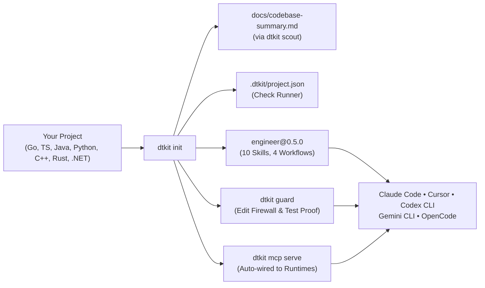
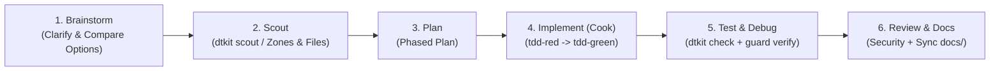

# DTKit User Guide

Welcome to **DTKit**! This guide walks you through everything DTKit can do in plain language, with practical examples for solo developers and teams.

---

## 1. What Problem Does DTKit Solve?

When you use AI coding agents (**Claude Code**, **Cursor**, **Codex CLI**, **Gemini CLI**, **OpenCode**), three everyday headaches show up fast:

1. **Every tool reads a different config format:** `CLAUDE.md`, `.cursor/rules/*.mdc`, `AGENTS.md`, `GEMINI.md`, `.opencode/skills/`, and different MCP/hook files. Keeping them in sync by hand breaks easily.
2. **Static markdown rules get ignored:** Even with great rules, an AI agent can still jump straight into coding without a plan, edit files outside your requested folder, delete assertions to make failing tests pass, or claim *"all tests passed"* without running them.
3. **Polyglot repos waste context tokens:** Real projects mix stacks (for example `frontend/` in TypeScript, `backend/` in Java, `ai/` in Python). Letting the agent blindly `grep` everything burns tokens and slows down every task.

**DTKit fixes all three from a single Go binary**—and never overwrites your personal notes or configs.



---

## 2. Two-Minute Setup (`dtkit init`)

Inside any repository (single language or monorepo):

```bash
# Preview what dtkit init will set up (reads only, writes nothing)
dtkit init --runtime claude --with-mcp --with-hooks --lock --dry-run

# Apply the full setup
dtkit init --runtime claude --with-mcp --with-hooks --lock --yes
```

Using more than one coding agent on the same project? Replace `--runtime claude` with `--all-runtimes`:

```bash
dtkit init --all-runtimes --with-mcp --with-hooks --lock --yes
```

What this single command creates safely:
- `docs/codebase-summary.md`: Auto-generated map of your workspace zones, languages, manifests, and API contracts (`openapi.*`, `*.proto`, `*.graphql`).
- `.dtkit/project.json`: Detected `test` / `lint` / `typecheck` commands per zone (you explicitly approve them on first `dtkit check --yes`).
- **Bundled `engineer@0.5.0` kit** installed cleanly for your chosen runtime(s) without overwriting your own instructions outside DTKit's managed block (`<!-- dtkit:begin ... -->`).
- **MCP config** wired automatically (`.mcp.json`, `.cursor/mcp.json`, `.gemini/settings.json`, `opencode.json`, `.codex/mcp.json`) keeping all your existing MCP servers intact.
- **Opt-in quality hooks** enabled (`check-changed`, `guard-edit`, or `session-context`).
- **`dtkit.lock`** pinning exact kit versions and digests for your teammates.

> **Git tip:** Add `.dtkit/local/` to your `.gitignore`. DTKit keeps locks, journals, guard policies, check trust approvals, and companion caches inside `.dtkit/local/` so personal machine state is never committed.

---

## 3. How the `engineer` Kit Works Day-to-Day

Instead of separate fragmented kits per programming language, DTKit ships **one unified `engineer` kit** designed around the engineering lifecycle—and uses `dtkit scout` + `docs/` to adapt to **any tech stack**:



### Included Skills (10) & Workflows (4)
- **Read-only discovery & design:** `brainstorm`, `scout`, `plan`, `explain`, `ask`
- **Execution & verification:** `implement`, `debug`, `test`
- **Quality & living memory:** `review` (includes security checklist), `docs` (keeps `docs/codebase-summary.md`, `docs/system-architecture.md`, and `docs/code-standards.md` accurate)
- **End-to-end workflows:** `feature`, `bugfix`, `review`, `bootstrap-docs`

### Selecting a Lighter Preset
If you only want planning or review helpers instead of the full 19-component kit:

```bash
# Lightweight: ask + explain + plan only
dtkit install engineer --project --runtime claude --preset minimal --yes

# Reviewer setup: review + review-report template + review workflow
dtkit install engineer --project --runtime claude --preset review-only --yes
```

---

## 4. Protecting Your Repo (`dtkit scout`, `dtkit guard`, `dtkit check`)

### 4.1. Fast Polyglot Reconnaissance (`dtkit scout`)
Before asking an AI to touch a large repo, map it or pack only the relevant zone with secrets automatically redacted:

```bash
# Overview of all zones (FE, BE, AI, DB) and languages
dtkit scout

# Search for files matching "checkout" inside "backend" and pack redacted snippets (max 24 KiB)
dtkit scout --zone backend --query checkout --pack --max-bytes 24576

# Refresh docs/codebase-summary.md after structural changes
dtkit scout --write-summary

# Check reverse-dependency blast radius & related tests before editing a core file
dtkit scout --impact backend/src/main/java/com/acme/Token.java
```

DTKit automatically skips `.git`, `node_modules`, `dist`, `build`, `target`, `.venv`, binary files, symlinks outside root, `.env*`, and private key files (`*.pem`, `*.key`), and masks API tokens in snippets.

### 4.2. Phase Edit Firewall (`dtkit guard`)
Want to make sure the AI does **not** edit code while brainstorming, reviewing, or working inside one module? Lock the firewall:

```bash
# Mode 1: Block 100% of file edits during planning/review
dtkit guard lock --mode read-only

# Mode 2: Red phase of TDD — allow editing test files ONLY
dtkit guard lock --mode tdd-red

# Mode 3: Green phase of TDD — allow source edits, lock test files against AI tampering
dtkit guard lock --mode tdd-green --allow "backend/**"

# Mode 4: Restrict edits strictly to one folder
dtkit guard lock --mode scoped --allow "frontend/src/**" --protect-tests

# Release lock when done
dtkit guard unlock
```

Because `.dtkit/local/guard.json` is itself write-protected by `guard-edit` hooks, the AI agent cannot edit its own firewall policy.

### 4.3. Cryptographic Check Proof & Test-Tampering Protection
Every time `dtkit check --all` passes (`fail=0`, `missing_tool=0`, `timeout=0`), DTKit computes a SHA-256 digest of your workspace and saves a receipt in `.dtkit/local/verify-receipt.json`.

```bash
# Trust and run project checks
dtkit check --all --yes

# Verify receipt matches current workspace digest AND no test skips/dropped assertions exist
dtkit guard verify
```

If an AI modifies even 1 byte of code after tests passed—or inserts `t.Skip`, `pytest.skip`, `.skip(`, `@Disabled`, `GTEST_SKIP`, `#[ignore]`, or deletes assertions—`dtkit guard verify` exits with code `3` (`verification_failed`), and `check-changed` hooks inject `[TEST TAMPERING WARNING]` or `[RETRY LOOP DETECTED]` (after 3 consecutive failing runs) directly into the agent's context.

---

## 5. Importing Community Repos & External Tools (`dtkit integrate`)

### 5.1. Import Community Skill/Rule Repos (Superpowers, Cursor `.mdc`, Claude Commands)
Found a great skill/rule repository on GitHub (like `obra/superpowers`, Anthropic skills, or `.cursor/rules/*.mdc` packs)? Pass a local folder, GitHub `owner/repo` shorthand, or HTTPS Git URL and let DTKit convert it into a validated 5-runtime kit:

```bash
# Preview what will be imported (reads only)
dtkit integrate import obra/superpowers --as superpowers --dry-run

# Convert AND install side-by-side with engineer (Multi-Kit v3)
dtkit integrate import obra/superpowers --as superpowers --install --runtime claude --yes

# Refresh an already-imported kit atomically when upstream updates
dtkit integrate import obra/superpowers --as superpowers --update --install --runtime claude --yes

# Check both kits running together cleanly
dtkit status --project --runtime claude
```

### 5.2. Connect External Companions (`repomix`, `graphify`, `ast-grep`, `semgrep`)
If you already have tools like `repomix`, `graphify`, `ast-grep` (`sg`), or `semgrep` installed, DTKit caches their output by SHA-256 workspace digest so unchanged code returns in milliseconds—and falls back gracefully to `dtkit scout` when missing:

```bash
# See which companion tools are detected on PATH
dtkit integrate list

# Run repomix scoped to backend/ (cached automatically by workspace digest; falls back to dtkit scout if absent)
dtkit integrate run repomix --zone backend

# Register ast-grep cleanly in .dtkit/project.json (still requires your dtkit check --yes trust approval)
dtkit integrate tool ast-grep --yes
```

---

## 6. Safe Customization, Lockfiles & Team Onboarding

### 6.1. Fork & Customize Without Breaking Updates
Never edit DTKit-managed files directly inside `.claude/skills/` or `.agents/skills/`—that causes drift protection (`exit 3`). Instead, fork a local copy:

```bash
dtkit fork engineer --as company-engineer --dir ./kits
# Edit ./kits/company-engineer/rules/engineering.md, preview diff, then install/update:
dtkit diff company-engineer --from ./kits/company-engineer --project --runtime claude
dtkit install company-engineer --from ./kits/company-engineer --project --runtime claude --yes
```

### 6.2. Team Sync with `dtkit.lock` & `dtkit team`
```bash
# Maintainer exports portable lockfile + secret-free team bundle
dtkit lock generate --yes
dtkit team export --out team-bundle.json

# Teammate clones repo and installs identical kit versions & verified digests
dtkit team import team-bundle.json --yes
dtkit sync --offline --yes
```

### 6.3. Diagnostics & Recovery
- **Something look wrong or drifted?** Run `dtkit doctor --redact` (scrubs home paths and tokens before pasting diagnostics into issues).
- **An operation crashed mid-write?** Run `dtkit recover --project --dry-run` then `dtkit recover --project --yes` to replay or roll back atomically.

---

## Further Reading
- [CLI Flag & Exit Code Reference](cli.md)
- [Runtime Compatibility & Evidence Matrix](compatibility.md)
- [Release, Terminal Install & Troubleshooting](release.md)
- [Version Support & Deprecation Policy](compatibility-policy.md)
