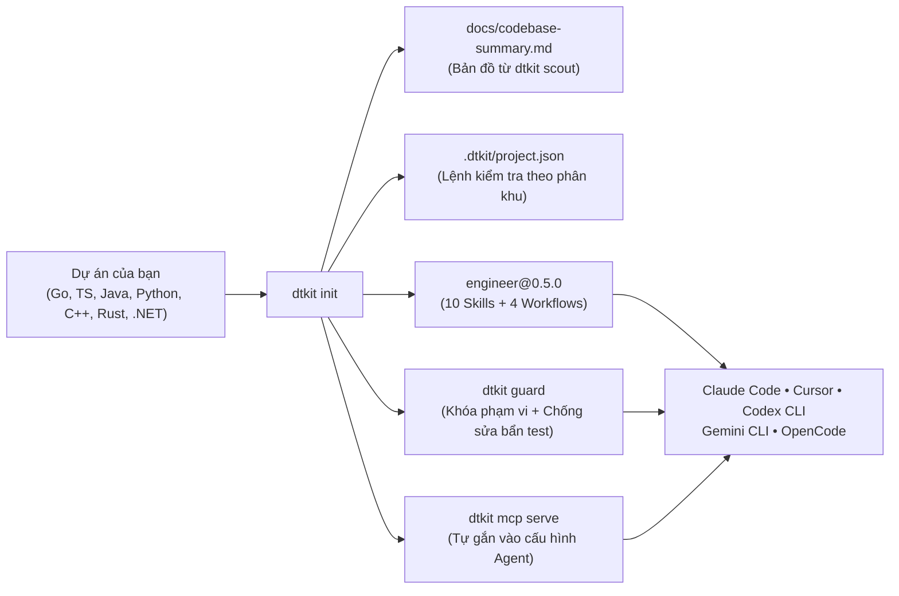
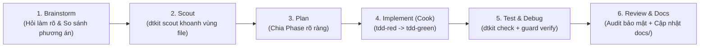

# Hướng Dẫn Sử Dụng DTKit (Tiếng Việt)

Chào mừng bạn đến với **DTKit**! Tài liệu này giải thích rõ ràng, dễ hiểu cách DTKit hoạt động và cách áp dụng thực tế cho dự án cá nhân lẫn làm việc nhóm.

---

## 1. DTKit Giải Quyết Vấn Đề Gì?

Khi lập trình cùng AI Agent (**Claude Code**, **Cursor**, **Codex CLI**, **Gemini CLI**, **OpenCode**), hầu như ai cũng gặp 3 vấn đề khó chịu:

1. **Mỗi công cụ đọc một kiểu file khác nhau:** `CLAUDE.md`, `.cursor/rules/*.mdc`, `AGENTS.md`, `GEMINI.md`, `.opencode/skills/`, cùng file cấu hình MCP và Hook hoàn toàn khác nhau. Team dùng nhiều IDE là cấu hình lệch nhau ngay.
2. **File `.md` tĩnh rất hay bị AI lờ đi:** Dù bạn dặn kỹ trong rule, AI vẫn có thể nhảy vào sửa code khi chưa lập kế hoạch, sửa tràn lan sang thư mục khác, tự ý xoá assertion/thêm `skip` để test pass giả, hoặc báo *"All tests passed"* khi chưa hề chạy test.
3. **Dự án nhiều ngôn ngữ tốn rất nhiều token:** Repo thực tế hay có `frontend/` (TypeScript), `backend/` (Java), `ai/` (Python)... Nếu để AI tự mò `grep` cả repo thì vừa chậm vừa tốn context.

**DTKit gói gọn giải pháp vào duy nhất 1 file thực thi Go**, chạy offline siêu nhanh và **tuyệt đối không ghi đè dữ liệu riêng của bạn**.



---

## 2. Bắt Đầu Trong 30 Giây (`dtkit init`)

Đứng trong thư mục gốc của bất kỳ dự án nào, chỉ cần chạy **1 lệnh**:

```bash
# Xem trước những gì dtkit init sẽ thiết lập (chỉ đọc, chưa ghi gì xuống ổ cứng)
dtkit init --runtime claude --with-mcp --with-hooks --lock --dry-run

# Cài đặt trọn gói
dtkit init --runtime claude --with-mcp --with-hooks --lock --yes
```

Nếu team bạn dùng nhiều công cụ AI cùng lúc, thay `--runtime claude` bằng `--all-runtimes`:

```bash
dtkit init --all-runtimes --with-mcp --with-hooks --lock --yes
```

Chỉ sau 1 lệnh đó, DTKit tự động chuẩn bị sẵn cho bạn:
1. **`docs/codebase-summary.md`:** Bản đồ tổng quan các phân khu (`frontend`, `backend`, `ai`, `core`...), ngôn ngữ, manifest và API contracts (`openapi.*`, `*.proto`, `*.graphql`).
2. **`.dtkit/project.json`:** Các lệnh `test`/`lint`/`typecheck` tương ứng cho từng phân khu (an toàn: bạn tự duyệt qua `dtkit check --yes` ở lần chạy đầu tiên).
3. **Bộ kit `engineer@0.5.0`:** Cài sạch sẽ vào đúng thư mục của từng runtime, giữ nguyên 100% nội dung cá nhân nằm ngoài block quản lý `<!-- dtkit:begin ... -->`.
4. **Cấu hình MCP tự động:** Gắn sẵn `dtkit mcp serve` vào `.mcp.json` / `.cursor/mcp.json` / `.gemini/settings.json` / `opencode.json` / `.codex/mcp.json` mà không làm mất các MCP server bạn đã cài trước đó.
5. **Opt-in Quality Hooks & `dtkit.lock`:** Bật hook tự kiểm tra và ghim phiên bản vào `dtkit.lock` cho cả team dùng chung.

> **Mẹo Git:** Hãy thêm `.dtkit/local/` vào `.gitignore` để không commit nhầm file lock máy cá nhân, nhật ký giao dịch hay bộ nhớ đệm tạm.

---

## 3. Quy Trình Làm Việc Của Bộ Kit `engineer@0.5.0`

Thay vì chia vụn mỗi ngôn ngữ một kit, DTKit dùng **1 kit `engineer` thống nhất** lấy cảm hứng từ luồng làm việc chuẩn kỹ sư (kiểu AgentKit/ClaudeKit) và kết hợp với `dtkit scout` + `docs/` để tự thích nghi với mọi ngôn ngữ:



- **Nhóm chỉ đọc (nghiêm cấm sửa file):** `brainstorm`, `scout`, `plan`, `explain`, `ask`
- **Nhóm thực thi & kiểm chứng:** `implement`, `debug`, `test`
- **Nhóm kiểm toán & đồng bộ tài liệu:** `review` (tích hợp checklist bảo mật), `docs` (cập nhật `docs/codebase-summary.md`, `docs/system-architecture.md`, `docs/code-standards.md`)
- **4 quy trình chuẩn:** `feature`, `bugfix`, `review`, `bootstrap-docs`

Nếu chỉ cần cài gọn nhẹ (chỉ lấy phần hỏi/giải thích/lập kế hoạch hoặc chỉ review):

```bash
dtkit install engineer --project --runtime claude --preset minimal --yes
dtkit install engineer --project --runtime claude --preset review-only --yes
```

---

## 4. Ba Lớp Bảo Vệ Thực Chiến (`scout`, `guard`, `verify`)

### 4.1. Trinh Sát Đa Ngôn Ngữ (`dtkit scout`)
Khi mở một repo lạ hoặc monorepo (FE TS + BE Java + AI Python):

```bash
# Xem tổng quan phân khu, ngôn ngữ, số dòng và API contract
dtkit scout

# Tìm file liên quan "checkout" riêng trong "backend/", đóng gói kèm snippet đã che secret (tối đa 24 KiB)
dtkit scout --zone backend --query checkout --pack --max-bytes 24576

# Cập nhật lại docs/codebase-summary.md
dtkit scout --write-summary

# Tính trước bán kính ảnh hưởng & danh sách file test liên quan trước khi sửa một file lõi
dtkit scout --impact backend/src/main/java/com/acme/Token.java
```

`dtkit scout` luôn bỏ qua `.git`, `node_modules`, `dist`, `build`, `target`, `.venv`, file binary, symlink thoát thư mục, `.env*`, private key (`*.pem`, `*.key`) và tự che token/API key trong kết quả.

### 4.2. Tường Lửa Khóa Phạm Vi Sửa File (`dtkit guard`)
Muốn ép AI **không được sửa bậy** khi đang phân tích hoặc chỉ được sửa đúng 1 thư mục?

```bash
# Chế độ 1: Cấm tuyệt đối sửa mọi file (khi đang brainstorm / plan / review)
dtkit guard lock --mode read-only

# Chế độ 2: TDD Red — chỉ cho AI viết/sửa file test
dtkit guard lock --mode tdd-red

# Chế độ 3: TDD Green — cho sửa code chính, khóa cứng không cho AI sửa/xóa file test
dtkit guard lock --mode tdd-green --allow "backend/**"

# Chế độ 4: Khóa gọn AI chỉ được đụng vào 1 thư mục cụ thể
dtkit guard lock --mode scoped --allow "frontend/src/**" --protect-tests

# Mở khóa khi làm xong
dtkit guard unlock
```

File luật `.dtkit/local/guard.json` tự động được bảo vệ ở tầng Hook nên chính AI không bao giờ tự sửa hay xóa được luật của bạn.

### 4.3. Biên Lai Xác Thực Test Thật & Chống Sửa Bẩn Test (`dtkit guard verify`)
Mỗi lần `dtkit check` thực sự chạy **pass 100%**, DTKit băm SHA-256 toàn bộ trạng thái code và lưu biên lai vào `.dtkit/local/verify-receipt.json`.

```bash
dtkit check --all --yes
dtkit guard verify
```

Nếu AI sửa thêm dù chỉ 1 dòng code mà chưa chạy lại test, hoặc lén chèn `t.Skip` / `pytest.skip` / `.skip(` / `@Disabled` / `GTEST_SKIP` / `#[ignore]` hay xóa assertion trong bài test:
- `dtkit guard verify` trả mã lỗi `3` (`verification_failed`).
- Hook `check-changed` tự động bơm cảnh báo `[TEST TAMPERING WARNING]` (hoặc `[RETRY LOOP DETECTED]` nếu fail $\ge 3$ lần liên tiếp) thẳng vào phiên làm việc của Agent.

---

## 5. Nhập Repo Cộng Đồng & Dùng Kèm Công Cụ Ngoài (`dtkit integrate`)

### 5.1. Đưa Repo Skills/Rules Ngoài (Superpowers, Cursor `.mdc`, Claude Commands) Lên Cả 5 Runtime
Bạn thấy một repo hay trên GitHub (ví dụ `obra/superpowers`, kho skill Anthropic, hoặc bộ `.cursor/rules/*.mdc`)? Truyền trực tiếp thư mục local, shorthand `owner/repo` của GitHub, hoặc HTTPS Git URL để chuyển đổi bằng 1 lệnh:

```bash
# Xem trước kết quả chuyển đổi (không ghi đĩa)
dtkit integrate import obra/superpowers --as superpowers --dry-run

# Chuyển đổi thành gói DTKit chuẩn VÀ cài luôn song song với engineer (Multi-Kit v3)
dtkit integrate import obra/superpowers --as superpowers --install --runtime claude --yes

# Cập nhật lại kit đã import khi repo nguồn có phiên bản mới
dtkit integrate import obra/superpowers --as superpowers --update --install --runtime claude --yes

# Kiểm tra cả 2 kit cùng hoạt động bình thường
dtkit status --project --runtime claude
```

### 5.2. Kết Nối Công Cụ Ngoài (`repomix`, `graphify`, `ast-grep`, `semgrep`) Có Cache
Nếu máy đã cài sẵn `repomix`, `graphify`, `ast-grep` (`sg`), hoặc `semgrep`:

```bash
# Kiểm tra máy đang có sẵn công cụ nào
dtkit integrate list

# Chạy repomix riêng cho phân khu backend/ — tự động lưu cache theo mã băm code;
# nếu máy chưa cài repomix thì tự động dùng dtkit scout thay thế
dtkit integrate run repomix --zone backend

# Đăng ký ast-grep vào .dtkit/project.json (vẫn cần bạn duyệt bằng dtkit check --yes)
dtkit integrate tool ast-grep --yes
```

---

## 6. Tuỳ Biến An Toàn & Làm Việc Nhóm

- **Sửa kit theo ý công ty mà vẫn nâng cấp được (`dtkit fork`):**
  ```bash
  dtkit fork engineer --as company-engineer --dir ./kits
  dtkit diff company-engineer --from ./kits/company-engineer --project --runtime claude
  dtkit install company-engineer --from ./kits/company-engineer --project --runtime claude --yes
  ```
- **Đồng bộ team không dính path máy cá nhân (`dtkit lock`, `dtkit team`):**
  ```bash
  dtkit lock generate --yes
  dtkit team export --out team-bundle.json
  # Đồng nghiệp chỉ việc:
  dtkit team import team-bundle.json --yes
  dtkit sync --offline --yes
  ```
- **Kiểm tra sức khoẻ / Khôi phục sự cố:**
  - Chạy `dtkit doctor --redact` để kiểm tra lỗi môi trường mà vẫn che sạch đường dẫn `$HOME` và token.
  - Chạy `dtkit recover --project --yes` nếu một lệnh cài/gỡ bị ngắt ngang giữa chừng.

---

## Tài Liệu Tham Khảo Thêm
- [Bảng lệnh CLI & Mã thoát chi tiết](cli.md)
- [Ma trận tương thích 5 Agent Runtimes](compatibility.md)
- [Hướng dẫn cài binary & Khắc phục sự cố](release.md)
