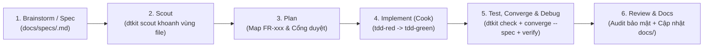

# Hướng Dẫn Sử Dụng DTKit (Tiếng Việt)

Chào mừng bạn đến với **DTKit**! Tài liệu này giải thích dễ hiểu, trực quan toàn bộ cách DTKit hoạt động, các file nó tạo ra và quy trình áp dụng thực tế cho dự án cá nhân lẫn làm việc nhóm.

---

## 1. DTKit Giải Quyết Vấn Đề Gì?

Khi lập trình cùng AI Agent (**Claude Code**, **Cursor**, **Codex CLI**, **Gemini CLI**, **OpenCode**), hầu như ai cũng gặp 3 vấn đề khó chịu:

1. **Mỗi công cụ đọc một kiểu file khác nhau:** `CLAUDE.md`, `.cursor/rules/*.mdc`, `AGENTS.md`, `GEMINI.md`, `.opencode/skills/`, cùng file cấu hình MCP (`json`/`toml`) và Hook hoàn toàn khác nhau. Team dùng nhiều IDE là cấu hình lệch nhau ngay.
2. **File `.md` tĩnh rất hay bị AI lờ đi:** Dù bạn dặn kỹ trong rule, AI vẫn có thể nhảy vào sửa code khi chưa lập kế hoạch, sửa tràn lan sang thư mục khác, tự ý xoá assertion/thêm `skip` để test pass giả, hoặc báo *"All tests passed"* khi chưa hề chạy test.
3. **Dự án nhiều ngôn ngữ tốn rất nhiều token:** Repo thực tế hay có `frontend/` (TypeScript), `backend/` (Java), `ai/` (Python)... Nếu để AI tự mò `grep` cả repo thì vừa chậm vừa tốn context.

**DTKit gói gọn giải pháp vào duy nhất 1 file thực thi Go**, chạy offline siêu nhanh và **tuyệt đối không ghi đè dữ liệu riêng của bạn**.

### Bạn Chỉ Cần Nhớ Đúng 4 Lệnh Chính

| Lệnh | Dùng khi nào | Tác dụng |
|---|---|---|
| `dtkit init` | Lần đầu cài vào dự án | Tạo bản đồ `docs/codebase-summary.md`, `.dtkit/project.json`, cài `engineer@0.7.0`, gắn MCP/hooks và `dtkit.lock`. |
| `dtkit scout` | Trước khi giao task cho AI | Quét repo chỉ đọc (`dtkit scout`), gói snippet sạch secret (`--pack`), hoặc đo bán kính ảnh hưởng (`--impact <file>`). |
| `dtkit spec` | Khi làm tính năng mới / lớn | Tạo khung (`init <slug>`) hoặc kiểm tra (`check`) file `docs/specs/<slug>.md` (`P1/P2`, `Given/When/Then`, `FR-xxx`, `SC-xxx`, `[NEEDS CLARIFICATION]`). |
| `dtkit converge` | Sau khi code / trước lúc review | Soi lệch giữa **Spec ↔ Plan ↔ Code** chỉ đọc (`--spec <file> --dry-run`) hoặc nối thêm task còn thiếu (`--append-tasks <file> --yes`). |
| `dtkit guard` | Khi lập kế hoạch / code / test | Khóa phạm vi sửa file (`read-only`, `tdd-red`, `tdd-green`, `scoped`) và xác thực biên lai test thật (`verify`). |
| `dtkit update` *(hoặc `dtkit refresh`)* | Mỗi khi dự án lớn lên | **1 lệnh cập nhật tất cả:** làm mới `codebase-summary.md`, gộp stack mới vào `.dtkit/project.json` (giữ nguyên `checks` cũ), đồng bộ mọi kit + `.dtkit/overrides/` và `dtkit.lock`. |

```mermaid
flowchart LR
    Repo["Dự án của bạn\n(Go, TS, Java, Python, C++, Rust, .NET)"] --> Init["dtkit init / update"]
    Init --> Scout["docs/codebase-summary.md\n(Bản đồ từ dtkit scout)"]
    Init --> Prof[".dtkit/project.json\n(Lệnh kiểm tra theo phân khu)"]
    Init --> Kit["engineer@0.7.0\n(11 Skills, 4 Workflows, Spec)"]
    Init --> Guard["dtkit guard\n(Khóa phạm vi + Chống sửa bẩn test)"]
    Init --> MCP["dtkit mcp serve\n(Tự gắn vào cấu hình Agent)"]
    Kit --> Agents["Claude Code • Cursor • Codex CLI\nGemini CLI • OpenCode"]
    Guard --> Agents
    MCP --> Agents
```



---

## 2. Cài Đặt `dtkit` & Khởi Tạo Dự Án Trong 30 Giây

### 2.1. Cài `dtkit` chỉ với 1 lệnh (`v0.8.0` / `main`)
*(Script `install.sh` / `install.ps1` cài bản phát hành `v0.8.0`; dùng Docker `#main` hoặc `go install ...@main` nếu bạn muốn dùng ngay `engineer@0.7.0`, `dtkit spec` và `dtkit converge` trên `main`.)*
- **macOS / Linux (`v0.8.0`, tự kiểm tra `SHA256SUMS`):**
  `curl -fsSL https://raw.githubusercontent.com/truong-newbie/Agent_Kit_Impl/main/scripts/install.sh | bash`
- **Windows PowerShell (`v0.8.0`, tự kiểm tra `SHA256SUMS`):**
  `irm https://raw.githubusercontent.com/truong-newbie/Agent_Kit_Impl/main/scripts/install.ps1 | iex`
- **Docker Desktop (`main` — khuyên dùng nếu máy Windows bật Application Control / Smart App Control chặn file `.exe`):**
  ```powershell
  docker build -t dtkit:main https://github.com/truong-newbie/Agent_Kit_Impl.git#main
  # Thêm vào PowerShell ($PROFILE):
  function dtkit { docker run --rm -i -v "${PWD}:/work" -w /work dtkit:main @args }
  ```
  Khi chạy từ container Linux trên Windows, khởi tạo dự án bằng `dtkit init --runtime codex --with-mcp --lock --yes` (bỏ `--with-hooks`), và nếu nối MCP cho app Windows hãy trỏ `command` tới `docker` với `args: ["run", "--rm", "-i", "-v", "<Đường-dẫn-dự-án>:/work", "-w", "/work", "dtkit:main", "mcp", "serve", "--path", "/work"]`.
- **Cách khác (`v0.8.0`):** Scoop (`https://github.com/truong-newbie/Agent_Kit_Impl/releases/download/v0.8.0/dtkit.json`), Homebrew 4+ (`curl -fsSLO https://github.com/truong-newbie/Agent_Kit_Impl/releases/download/v0.8.0/dtkit.rb && HOMEBREW_NO_INSTALL_FROM_API=1 brew install --formula "$(pwd)/dtkit.rb"`), hoặc `go install github.com/truong-newbie/Agent_Kit_Impl/cmd/dtkit@v0.8.0` (`@main` để lấy bản mới nhất).

### 2.2. Khởi tạo cho dự án (`dtkit init`)
Đứng trong thư mục gốc của bất kỳ dự án nào, chỉ cần chạy **1 lệnh**:

```bash
# Xem trước những gì dtkit init sẽ thiết lập (chỉ đọc, chưa ghi gì xuống ổ cứng)
dtkit init --runtime claude --with-mcp --with-hooks --lock --dry-run

# Cài đặt trọn gói
dtkit init --runtime claude --with-mcp --with-hooks --lock --yes
```

Nếu bạn dùng nhiều công cụ AI cùng lúc (hoặc làm việc team nhiều IDE), thay `--runtime claude` bằng `--all-runtimes`:

```bash
dtkit init --all-runtimes --with-mcp --with-hooks --lock --yes
```

### Sau khi chạy `dtkit init`, dự án có thêm những gì?

| File / Thư mục | Tác dụng | Có nên commit Git? |
|---|---|---|
| `docs/codebase-summary.md` | Bản đồ tổng quan các phân khu (`frontend`, `backend`, `ai`...), ngôn ngữ, manifest và API contracts (`openapi.*`, `*.proto`, `*.graphql`). | **Nên commit** |
| `.dtkit/project.json` | Danh sách stack và lệnh `test`/`lint`/`typecheck` phát hiện được (bạn tự duyệt qua `dtkit check --yes` ở lần chạy đầu). | **Nên commit** |
| `.dtkit/content/` & `dtkit.lock` | Quy trình dùng chung của `engineer@0.7.0` và file khóa phiên bản giúp đồng đội `dtkit sync` giống hệt nhau. | **Nên commit** |
| `.dtkit/constitution.md` & `.dtkit/overrides/` | Hiến pháp kỹ thuật dự án (tùy chọn) và file ghi đè template cục bộ mà không cần fork kit. | **Nên commit** |
| `AGENTS.md`, `CLAUDE.md`, `GEMINI.md`, `.cursor/rules/`, `.agents/`, `.claude/`, `.gemini/`, `.opencode/` | Block hướng dẫn và bộ skills riêng cho từng agent; phần ghi chú cá nhân ngoài block `<!-- dtkit:begin ... -->` được giữ nguyên 100%. | **Nên commit** |
| `.mcp.json`, `.codex/config.toml`, `.cursor/mcp.json`, `.gemini/settings.json`, `opencode.json` | Gắn sẵn `dtkit mcp serve` (và hooks nếu dùng `--with-hooks`), không làm mất các MCP server khác của bạn. | **Nên commit / kiểm tra** |
| `.dtkit/local/` & `.dtkit/locks/` | Chế độ khóa `guard.json` cá nhân, biên lai `verify-receipt.json`, lock tạm, bộ nhớ đệm tạm. | **Thêm vào `.gitignore`** |

---

## 3. Quy Trình Làm Việc Của Bộ Kit `engineer@0.7.0`

Thay vì chia vụn mỗi ngôn ngữ một kit, DTKit dùng **1 kit `engineer` thống nhất** kết hợp với `dtkit scout` + `.dtkit/constitution.md` + `docs/` để tự thích nghi với mọi ngôn ngữ:



- **Nhóm chỉ đọc (nghiêm cấm sửa code):** `brainstorm` (xuất `docs/specs/<slug>.md` khi làm feature lớn), `scout`, `plan` (map `FR-xxx` từ spec, tôn trọng `.dtkit/constitution.md` / `docs/code-standards.md` và chờ bạn duyệt trước khi code), `explain`, `ask`
- **Nhóm thực thi & kiểm chứng:** `implement`, `debug`, `test`, `converge` (đối chiếu Spec ↔ Plan ↔ Code và nối task còn thiếu không ghi đè)
- **Nhóm kiểm toán & đồng bộ tài liệu:** `review` (tích hợp checklist bảo mật, đối chiếu spec & hiến pháp), `docs` (cập nhật `docs/codebase-summary.md`, `docs/system-architecture.md`, `docs/code-standards.md`)
- **4 quy trình chuẩn:** `feature`, `bugfix`, `review`, `bootstrap-docs`

### Cách Gọi `brainstorm`, `plan`, `implement`... (Terminal vs. Khung Chat AI)
Lưu ý rất quan trọng cho người mới: **không gõ `dtkit brainstorm` hay `dtkit plan` ngoài PowerShell/Terminal** (những cái đó là **Skills**, không phải lệnh CLI; riêng `dtkit spec` và `dtkit converge` có cả lệnh CLI hỗ trợ):
- **Ngoài Terminal (`dtkit ...`):** chỉ chạy lệnh quản lý & bảo vệ (`dtkit init`, `dtkit update`, `dtkit scout`, `dtkit spec`, `dtkit converge`, `dtkit guard`, `dtkit status`).
- **Bên trong khung chat với AI Agent:** gọi trực tiếp các skill mà `dtkit init` đã cài sẵn:
  - **Codex CLI / Antigravity (`--runtime agy`, thêm `$` phía trước):** `$dtkit-project-brainstorm`, `$dtkit-project-plan`, `$dtkit-project-implement`, `$dtkit-project-converge`, `$dtkit-project-review`
  - **Claude Code (thêm `/` phía trước):** `/dtkit-claude-project-brainstorm`, `/dtkit-claude-project-plan`, `/dtkit-claude-project-implement`, `/dtkit-claude-project-converge`, `/dtkit-claude-project-review`
  - **Gemini CLI / Cursor / OpenCode:** gõ `/` hoặc nhắc thẳng tên skill (`dtkit-gemini-project-plan`, `dtkit-cursor-project-plan`, `dtkit-opencode-project-plan`), hay dặn tự nhiên *"hãy brainstorm và lập plan trước, chưa sửa code"*.

Nếu chỉ cần cài gọn nhẹ (chỉ lấy phần hỏi/giải thích/lập kế hoạch hoặc chỉ review):

```bash
dtkit install engineer --project --runtime claude --preset minimal --yes
dtkit install engineer --project --runtime claude --preset review-only --yes
```

---

## 4. Ba Lớp Bảo Vệ Thực Chiến (`scout`, `guard`, `verify`)

### 4.1. Trinh Sát Đa Ngôn Ngữ (`dtkit scout`)
Khi mở một repo lạ hoặc monorepo (FE TS + BE Java + AI Python):

```bash
# Xem tổng quan phân khu, ngôn ngữ, số dòng và API contract
dtkit scout

# Tìm file liên quan "checkout" riêng trong "backend/", đóng gói kèm snippet đã che secret (tối đa 24 KiB)
dtkit scout --zone backend --query checkout --pack --max-bytes 24576

# Tính trước bán kính ảnh hưởng & danh sách file test liên quan trước khi sửa một file lõi
dtkit scout --impact backend/src/main/java/com/acme/Token.java

# Cập nhật riêng docs/codebase-summary.md
dtkit scout --write-summary
```

`dtkit scout` luôn bỏ qua `.git`, `node_modules`, `dist`, `build`, `target`, `.venv`, file binary, symlink thoát thư mục, `.env*`, private key (`*.pem`, `*.key`) và tự che token/API key trong kết quả.

### 4.2. Tường Lửa Khóa Phạm Vi Sửa File (`dtkit guard`)
Muốn ép AI **không được sửa bậy** khi đang phân tích hoặc chỉ được sửa đúng 1 thư mục?

```bash
# Chế độ 1: Cấm tuyệt đối sửa mọi file (khi đang brainstorm / plan / review)
dtkit guard lock --mode read-only

# Chế độ 2: TDD Red — chỉ cho AI viết/sửa file test
dtkit guard lock --mode tdd-red

# Chế độ 3: TDD Green — cho sửa code chính, khóa cứng không cho AI sửa/xóa file test
dtkit guard lock --mode tdd-green --allow "backend/**"

# Chế độ 4: Khóa gọn AI chỉ được đụng vào 1 thư mục cụ thể
dtkit guard lock --mode scoped --allow "frontend/src/**" --protect-tests

# Mở khóa khi làm xong
dtkit guard unlock
```

File luật `.dtkit/local/guard.json` tự động được bảo vệ ở tầng Hook nên chính AI không bao giờ tự sửa hay xóa được luật của bạn.

### 4.3. Biên Lai Xác Thực Test Thật & Chống Sửa Bẩn Test (`dtkit guard verify`)
Mỗi lần `dtkit check` thực sự chạy **pass 100%**, DTKit băm SHA-256 toàn bộ trạng thái code và lưu biên lai vào `.dtkit/local/verify-receipt.json`.

```bash
dtkit check --all --yes
dtkit guard verify
```

Nếu AI sửa thêm dù chỉ 1 dòng code mà chưa chạy lại test, hoặc lén chèn `t.Skip` / `pytest.skip` / `.skip(` / `@Disabled` / `GTEST_SKIP` / `#[ignore]` hay xóa assertion trong bài test:
- `dtkit guard verify` trả mã lỗi `3` (`verification_failed`).
- Hook `check-changed` tự động bơm cảnh báo `[TEST TAMPERING WARNING]` (hoặc `[RETRY LOOP DETECTED]` nếu fail ≥ 3 lần liên tiếp) thẳng vào phiên làm việc của Agent.

---

## 5. Cập Nhật Khi Dự Án Lớn Lên & Nhập Công Cụ Ngoài

### 5.1. Một Lệnh Cập Nhật Tất Cả (`dtkit update` / `dtkit refresh`)
Khi dự án phát triển thêm thư mục mới (ví dụ thêm `frontend/`, `ai/`), thêm code mới hoặc vừa nâng cấp kit, chỉ cần chạy **1 lệnh**:

```bash
# Xem trước những gì sẽ làm mới (chưa ghi file)
dtkit update --dry-run

# Làm mới trọn gói: gộp stack mới vào .dtkit/project.json (giữ nguyên checks cũ) + đồng bộ kits + dtkit.lock + docs/codebase-summary.md
dtkit update --yes
# (hoặc dùng alias tương đương: dtkit refresh --yes)
```

### 5.2. Đưa Repo Skills/Rules Cộng Đồng Lên Cả 5 Runtime (`dtkit integrate import`)
Bạn thấy một repo hay trên GitHub (ví dụ `obra/superpowers`, kho skill Anthropic, hoặc bộ `.cursor/rules/*.mdc`)? Truyền trực tiếp thư mục local, shorthand `owner/repo` của GitHub, hoặc HTTPS Git URL để chuyển đổi bằng 1 lệnh:

```bash
# Xem trước kết quả chuyển đổi (không ghi đĩa)
dtkit integrate import obra/superpowers --as superpowers --dry-run

# Chuyển đổi thành gói DTKit chuẩn VÀ cài luôn song song với engineer (Multi-Kit v3)
dtkit integrate import obra/superpowers --as superpowers --install --runtime claude --yes

# Cập nhật lại kit đã import khi repo nguồn có phiên bản mới (tự nâng patch version nếu nội dung thay đổi)
dtkit integrate import obra/superpowers --as superpowers --update --install --runtime claude --yes

# Kiểm tra cả 2 kit cùng hoạt động bình thường
dtkit status --project --runtime claude
```

### 5.3. Kết Nối Công Cụ Ngoài (`repomix`, `graphify`, `ast-grep`, `semgrep`) Có Cache
Nếu máy đã cài sẵn `repomix`, `graphify`, `ast-grep` (`sg`), hoặc `semgrep`:

```bash
# Kiểm tra máy đang có sẵn công cụ nào
dtkit integrate list

# Chạy repomix riêng cho phân khu backend/ — tự động lưu cache theo mã băm code;
# nếu máy chưa cài repomix thì tự động dùng dtkit scout thay thế
dtkit integrate run repomix --zone backend

# Đăng ký ast-grep vào .dtkit/project.json (vẫn cần bạn duyệt bằng dtkit check --yes)
dtkit integrate tool ast-grep --yes
```

---

## 6. Tuỳ Biến An Toàn & Làm Việc Nhóm

- **Ghi đè riêng 1 template/rule không cần fork (`.dtkit/overrides/<kit>/`):**
  Đặt file muốn sửa theo đúng đường dẫn tương đối của kit (ví dụ `.dtkit/overrides/engineer/skills/plan/SKILL.md.tmpl` hoặc `.dtkit/overrides/engineer/rules/engineering.md`) rồi chạy `dtkit update --yes`. DTKit tự động phủ lớp override đó lên bản gốc trong `install`, `update`, `diff` và `lock`.
- **Hoặc fork trọn bộ kit theo ý công ty mà vẫn nâng cấp được (`dtkit fork`):**
  ```bash
  dtkit fork engineer --as company-engineer --dir ./kits
  dtkit diff company-engineer --from ./kits/company-engineer --project --runtime claude
  dtkit install company-engineer --from ./kits/company-engineer --project --runtime claude --yes
  ```
- **Đồng bộ team không dính path máy cá nhân (`dtkit lock`, `dtkit team`):**
  ```bash
  dtkit lock generate --yes
  dtkit team export --out team-bundle.json
  # Đồng nghiệp chỉ việc:
  dtkit team import team-bundle.json --yes
  dtkit sync --offline --yes
  ```
- **Kiểm tra sức khoẻ / Khôi phục sự cố:**
  - Chạy `dtkit doctor --redact` để kiểm tra lỗi môi trường mà vẫn che sạch đường dẫn `$HOME` và token.
  - Chạy `dtkit recover --project --yes` nếu một lệnh cài/gỡ bị ngắt ngang giữa chừng.

---

## Tài Liệu Tham Khảo Thêm
- [Bảng lệnh CLI & Mã thoát chi tiết](cli.md)
- [Ma trận tương thích 5 Agent Runtimes](compatibility.md)
- [Hướng dẫn cài binary & Khắc phục sự cố](release.md)
